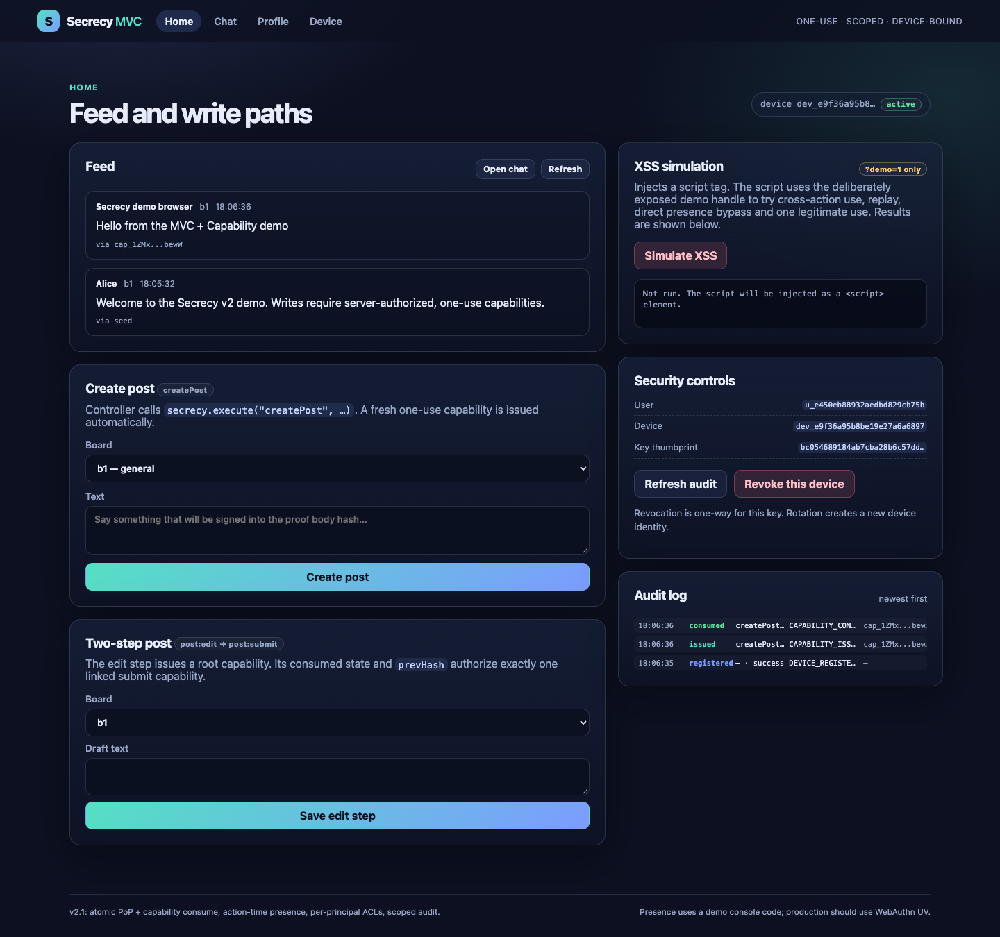
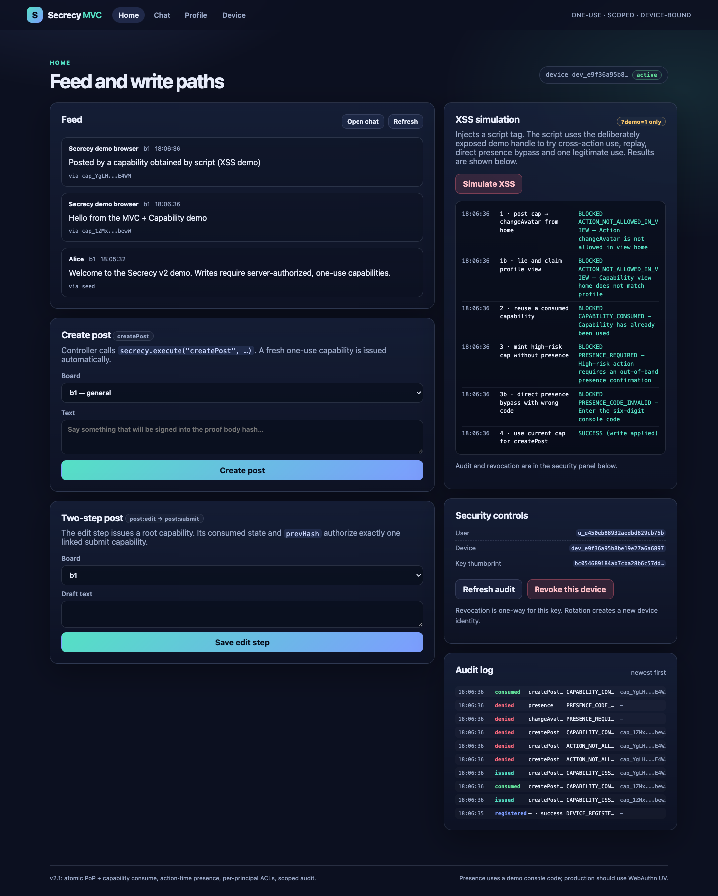

# MVC + Capability

### One-use, device-bound authority for every UI action


> **What if every action that could spam — post, change avatar, mention — required its own one-use, device-bound capability?**
>
> An XSS can burn the current one, but it can't mint new ones, can't reuse old ones, and leaves an audit trail.



---

## Why this exists

Most web apps authorize with **ambient authority**: “the user is logged in, so this
button works.” A single XSS then inherits everything the user can do.

This demo explores a different model:

- The **view** declares which actions it is allowed to surface.
- Every action gets a **fresh capability** bound to
  `device + action + view + scope + body`.
- The capability is **one-use**, consumed atomically on the server.
- High-risk actions need an **out-of-band presence confirmation**.
- A server-side **authorizer** checks the user may act on that resource — at
  issue **and** at use.
- Everything is **auditable and revocable**.

It is a teaching prototype and a design starting point, **not** a production
security library. See [docs/DESIGN.md](docs/DESIGN.md) and
[docs/FINAL-REPORT.md](docs/FINAL-REPORT.md) for the honest threat model.

---

## Try it in 30 seconds

```bash
npm start
# open http://127.0.0.1:8787
# XSS lab: http://127.0.0.1:8787/?demo=1
```

No dependencies. Node 22+ and a modern browser.

### A short walkthrough

1. **Device** — generate a non-extractable ECDSA P-256 key, prove possession,
   register the public JWK.
2. **Home** — write a post. A one-use `createPost` capability is issued,
   consumed, and audited.
3. **Chat** — send a message, or @mention someone. A mention has a different,
   broader scope; a plain chat capability cannot silently become a mention.
4. **Profile** — change the avatar. The server prints a six-digit code to the
   terminal; enter it in the modal. The presence token is bound to the exact
   `scopeHash`/`bodyHash` you saw.
5. **XSS lab** (`?demo=1`) — injects a real `<script>` that tries:
   - a post capability for `changeAvatar` → denied;
   - replay of a consumed capability → denied;
   - minting a high-risk capability without presence → denied;
   - a direct presence bypass with the wrong code → denied;
   - one allowed post → succeeds once, then the capability is gone.



---

## What is enforced

| Attack | Result |
|---|---|
| Replay a consumed capability | `CAPABILITY_CONSUMED` |
| Concurrent double-spend of one capability | exactly one success (2/50 parallel tests) |
| Use a post capability to change avatar | `ACTION_NOT_ALLOWED_IN_VIEW` |
| Call a profile action from home | `ACTION_NOT_ALLOWED_IN_VIEW` |
| Tamper with scope/body | `INVALID_CAPABILITY` / `SCOPE_DENIED` |
| Use a capability from another device | `DEVICE_MISMATCH` |
| Write to a board/chat you are not a member of | `FORBIDDEN` |
| Keep using a capability after membership is revoked | `FORBIDDEN` at use |
| High-risk action without presence | `PRESENCE_REQUIRED` |
| Wrong OOB code | `PRESENCE_CODE_INVALID` |
| Reuse a presence token for a different scope/body | `PRESENCE_SCOPE_MISMATCH` |
| Replay a registration PoP challenge | one session only (2/50 parallel tests) |
| Re-register a revoked JWK with padding/whitespace | rejected; stays revoked |
| Anonymous audit read | `401` |
| Action after device revocation | `DEVICE_REVOKED` |
| Skip/reuse a two-step post | `SEQ_MISMATCH` / `CAPABILITY_CONSUMED` |
| Mutate a draft between edit and submit | `DRAFT_HASH_MISMATCH` |

---

## Developer API

Business code never touches crypto, capability tokens, proofs or presence
tokens:

```js
const secrecy = new Secrecy({
  api: "/api",
  policy: window.SECRECY_POLICY,
  presenceProvider: new ModalCodePresenceProvider()
});

await secrecy.init(); // PoP challenge -> sign -> register

const home = secrecy.view("home");
await home.execute("createPost", {
  scope: { boardId: "b1" },
  body: { text: "hello" }
});
```

The policy manifest is declarative and client-safe:

```js
{
  views: {
    home:    { actions: ["createPost", "post:edit", "post:submit"] },
    chat:    { actions: ["sendMessage", "mention", "chat:join", "chat:leave"] },
    profile: { actions: ["changeAvatar"] }
  },
  actions: {
    createPost: {
      scope: { boardId: "BoardId" },
      body:  { text: "Text1to2000" },
      risk: "low", maxUses: 1, ttlSeconds: 300,
      presence: false,
      authorize: "board.write"        // resolved server-side
    },
    changeAvatar: {
      scope: { mime: "AvatarMime", maxSize: "Bytes1to104857600" },
      body:  { reason: "Text1to200" },
      risk: "high", maxUses: 1, ttlSeconds: 120,
      presence: true,
      authorize: "self.profile"
    }
  }
}
```

Server-side authorizers live in `src/server-policy.js` and are never shipped to
the browser:

```js
{
  "board.write":  (auth, scope) => boards.can(auth.userId, scope.boardId, "editor"),
  "chat.write":   (auth, scope) => chats.isMember(auth.userId, scope.chatId),
  "chat.mention": (auth, scope) => chats.canMention(auth.userId, scope.chatId, scope.userIds),
  "self.profile": (auth) => true
}
```

---

## Architecture

```text
Browser (MVC View)
  ├─ HttpOnly session cookie + CSRF        (production path)
  ├─ non-extractable device key (IndexedDB)
  └─ view/action descriptors
        │
        ▼
BFF / serverless API (Controller + PEP)
  ├─ POST /api/capabilities  → ACL check → mint one-use capability
  ├─ POST /api/action        → verify capability + PoP + scope/body + consume
  └─ server-policy.js        → board/chat/mention/self authorizers
        │
        ▼
Domain model / store (Model)
  ├─ business transaction
  ├─ atomic capability/presence/PoP consume
  └─ audit log
```

The client core is `src/public/secrecy.js` (under 500 lines). The shared protocol
helpers are in `src/public/protocol.js`; the server-only policy is in
`src/server-policy.js`.

---

## Tests

```bash
npm test               # 11 server checks
npm run test:security  # 19 security regression checks
```

Current local results:

```text
smoke       11 passed, 0 failed
security    19 passed, 0 failed
browser     18 passed, 0 failed   (Playwright, optional)
adversarial  5 passed, 0 failed   (Playwright, optional)
```

The security suite covers 2-way and 50-way concurrency, PoP replay, presence
scope/body substitution, ACL continuity, JWK canonicalization, revocation,
audit redaction, proof tampering, policy validation and draft re-hashing.

Optional browser tests live in `src/test/browser/` and read the OOB presence code
from a server log. See [src/test/browser/README.md](src/test/browser/README.md).

---

## What is deliberately not a security boundary

- **Same-origin XSS can use the current capability once.** This is bounded,
  scoped, detectable and revocable — not XSS-proof.
- **The OOB console code is a demo channel.** It is not WebAuthn UV; same-page
  XSS can keylog it after the user types it. The production contract is
  documented, but a full WebAuthn verifier is not implemented.
- **In-memory, single-process store.** `consumeCapability` is atomic in one
  process only; production needs DB conditional updates/CAS.
- **HMAC capability signatures** are symmetric/process-local. The server store
  is the real authority.
- **Bearer sessions** are held in JS memory. Production needs a BFF, HttpOnly
  cookies, CSRF, rotation and logout.
- **No idempotency/receipt lookup**, per-capability revocation, tamper-evident
  audit, or distributed rate limits.
- **No CSP** because the demo injects a script. Production needs strict CSP,
  Trusted Types, SRI, and a separate origin for the lab.
- `?demo=1` is build hygiene, not a security boundary. A production build must
  omit `demo-hooks.js` and `window.secrecy`.

The honest claim:

> **Authority is bounded to a server-authorized scope, single-use after the
> atomic commit, device-bound, auditable and revocable.**

---

## Docs

- [docs/FINAL-REPORT.md](docs/FINAL-REPORT.md) — Chinese design report: what was
  built, the API, test results, iteration history, production path.
- [docs/RESEARCH.md](docs/RESEARCH.md) — prior art: object-capability, Sandstorm
  Powerbox, TBAC/UCON, DPoP, WebAuthn, macaroons/Biscuit/UCAN, transaction
  authorization, and the main pitfalls.
- [docs/DESIGN.md](docs/DESIGN.md) — architecture, threat model, API, extension
  path.
- [docs/REVIEW.md](docs/REVIEW.md) / [docs/REVIEW-V2.md](docs/REVIEW-V2.md) —
  independent reviews and the P0/P1 findings that drove v2/v2.1.
- [docs/V2.1-NOTES.md](docs/V2.1-NOTES.md) — latest change summary.

---

## File map

```text
mvc-secrecy/
  README.md
  LICENSE
  package.json
  src/
    server.js
    server-policy.js
    public/
      index.html
      app.js
      secrecy.js
      protocol.js
      presence.js
      policy.js
      demo-hooks.js
      styles.css
    test/
      smoke.mjs
      security.mjs
      browser/
        browser.mjs
        adversarial.mjs
  docs/
    DESIGN.md
    FINAL-REPORT.md
    RESEARCH.md
    REVIEW.md
    REVIEW-V2.md
    V2-NOTES.md
    V2.1-NOTES.md
```

---

## License

MIT. See [LICENSE](LICENSE).
